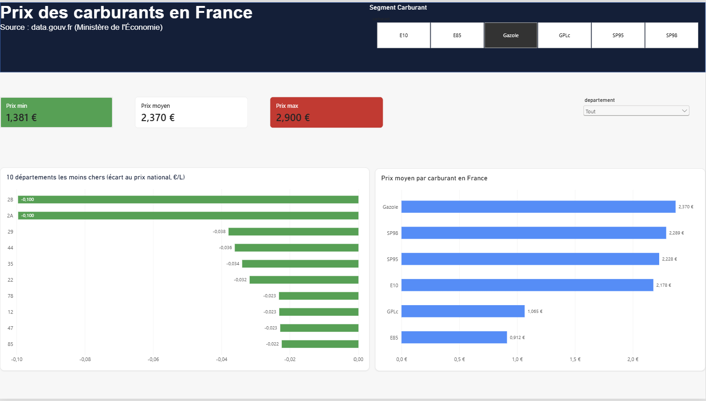
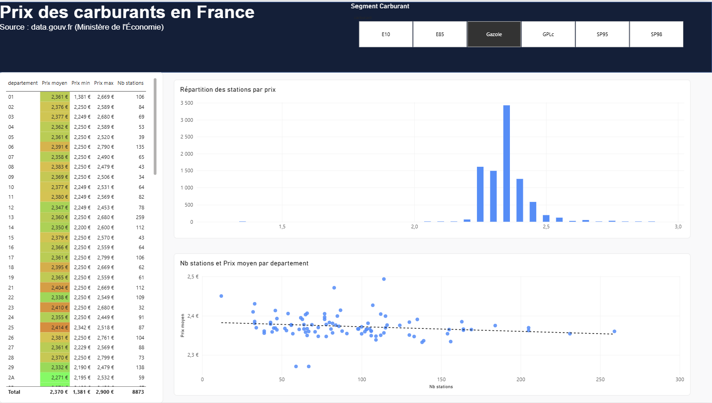
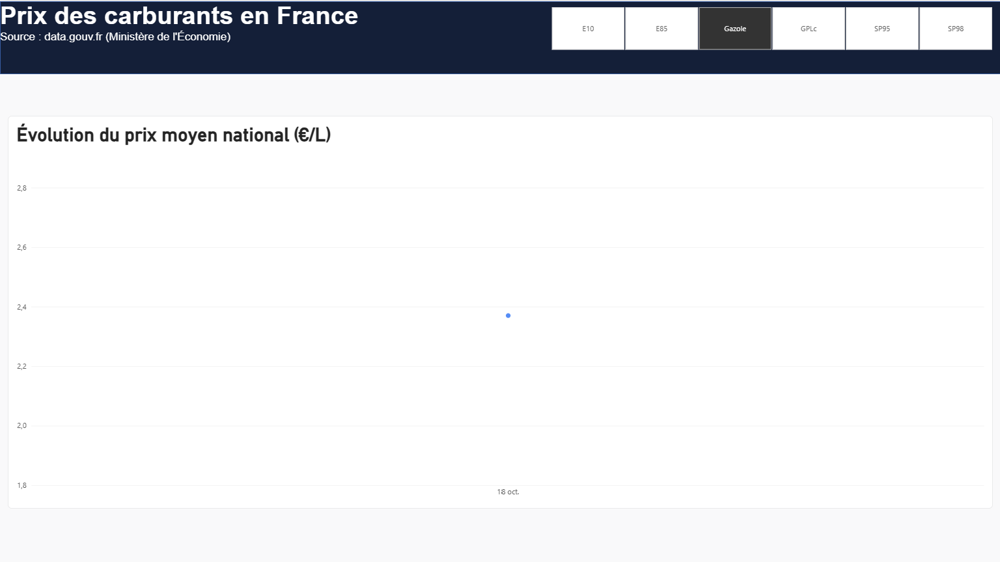

# Prix des carburants en France

Pipeline de données et dashboard Power BI sur les prix des carburants en France. Un script Python collecte chaque jour le flux open data officiel, le nettoie et alimente l'historique ; le tout tourne automatiquement sur GitHub Actions.



## Ce que fait le projet

1. **Collecte** : `scrapper.py` télécharge le flux officiel du Ministère de l'Économie ([prix-carburants.gouv.fr](https://www.prix-carburants.gouv.fr/rubrique/opendata/)), un ZIP contenant du XML.
2. **Nettoyage** : lecture du XML, conversion des coordonnées, calcul du département (Corse en 2A/2B, outre-mer sur 3 chiffres), suppression des prix aberrants.
3. **Historisation** : un instantané des stations et un historique agrégé par jour, qui grossit à chaque exécution.
4. **Automatisation** : un workflow GitHub Actions lance le script chaque jour et enregistre les nouveaux fichiers dans ce dépôt.
5. **Visualisation** : le dashboard Power BI lit les CSV directement depuis GitHub.

```
Flux open data (ZIP/XML) → scrapper.py → data/*.csv → GitHub Actions (quotidien) → Power BI
```

## Le dashboard

| Page | Contenu |
|---|---|
| **Vue d'ensemble** | choix du carburant, prix min / moyen / max, classement des 10 départements les moins chers (écart au prix national), prix moyen par carburant |
| **Analyse** | tableau des départements, nuage de points (nombre de stations et prix moyen par département, avec ligne de tendance), répartition des stations par tranche de prix |
| **Évolution** | courbe du prix moyen national, qui se complète chaque jour |




Le fichier du rapport est `dashboard_carburantFrance.pbix`. Les calculs (moyennes, écart au prix national) sont des mesures DAX : ils réagissent aux filtres du dashboard au lieu d'être figés.

## Données produites (`data/`)

| Fichier | Contenu | Évolution |
|---|---|---|
| `latest.csv` | une ligne par station : localisation et un prix par carburant | écrasé à chaque exécution |
| `history_departements.csv` | prix moyen, min, max et nombre de stations par jour, département et carburant | une journée de plus à chaque exécution |
| `history_national.csv` | idem, au niveau France | une journée de plus à chaque exécution |

L'historique est volontairement agrégé : conserver chaque jour l'ensemble des stations ferait grossir le dépôt de plusieurs centaines de Mo par an.

Les fichiers sont lisibles directement par n'importe quel outil à l'adresse :
`https://raw.githubusercontent.com/Wissemm697/CarburantFrance/main/data/latest.csv`

## Utilisation en local

```bash
pip install -r requirements.txt
python scrapper.py
```

Les fichiers sont créés dans le dossier `data/` du répertoire courant : lance la commande depuis la racine du projet.

## Automatisation

Le workflow `.github/workflows/update.yml` :

- se lance tous les jours à 05:00 UTC, ou à la demande depuis l'onglet Actions ;
- télécharge le dépôt sur une machine Linux temporaire, installe Python et les dépendances, exécute `scrapper.py` ;
- enregistre les fichiers de `data/` dans le dépôt, seulement s'ils ont changé.

La machine est supprimée après chaque exécution : c'est le dépôt qui sert de mémoire.

## Choix techniques

- **Source officielle plutôt que scraping HTML** : un flux structuré est plus stable et plus propre qu'un site à parser.
- **Lecture en mémoire** : le ZIP n'est jamais écrit sur le disque.
- **Garde-fou** : le script s'arrête sans rien écrire s'il lit moins de 1000 stations, pour ne pas écraser de bonnes données par un fichier cassé.
- **Plage de prix plausible par carburant** : par exemple 0,40 à 1,60 €/L pour l'E85. Les valeurs hors plage sont presque sûrement des erreurs de saisie des stations (un prix d'essence déclaré sur l'E85, par exemple) et sont ignorées.
- **Nettoyage côté script, analyse côté Power BI** : le script produit des données propres, Power BI s'occupe des calculs et des visuels.

## Limites connues

- Le flux ne contient **ni le nom ni la marque des stations** (exclus par le Ministère) : pas de comparaison par enseigne.
- Il ne fournit que les prix du moment : l'historique commence au premier jour de collecte (18 octobre 2026).
- Les prix sont déclarés par les stations et peuvent comporter des erreurs, malgré le filtrage.
- Le département est déduit du code postal, ce qui peut être inexact pour quelques communes situées à la limite de deux départements.

## Pistes d'évolution

- Carte des stations
- Noms des départements et carte colorée par département
- Variation sur 7 jours
- Actualisation automatique du rapport dans le service Power BI

## Source des données

Données ouvertes du Ministère de l'Économie, [prix-carburants.gouv.fr](https://www.prix-carburants.gouv.fr/rubrique/opendata/) (flux instantané).
